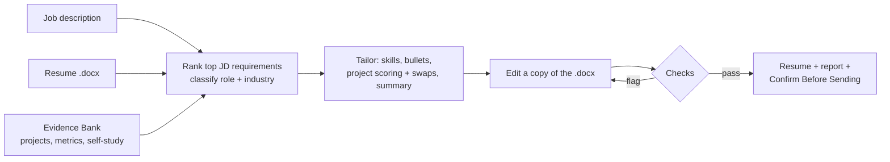

# Resume Evidence Tailor: a Claude Skill

A Claude skill that tailors a resume to a job posting using only facts the candidate has on file, keeps it on one page, and checks its own output before handing it over.

Give it a job description and a resume. It returns:
- **A tailored Word resume**
- **A report:** keyword match table, project scores, gap triage
- **A "Confirm Before Sending" list** of anything it couldn't verify

## Why

Generic AI resume tailoring tends to go wrong in three ways:
1. **It invents things:** a metric, a tool, a bigger scope.
2. **It sounds AI-written:** "leveraged", "spearheaded", every bullet built the same way.
3. **It breaks the layout:** the resume spills onto a second page.

This skill treats each of those as a rule it has to pass, not a style preference.

## How it works



The skill is modular: instructions (`SKILL.md`), a knowledge base (`evidence_bank.md`), role and industry profiles loaded only when they match, and Python checks. Details are in [docs/architecture.md](docs/architecture.md).

## Guardrails

- **Facts only from sources.** Every number and tool must appear in the resume or the Evidence Bank. Text in `[brackets]` is unconfirmed and never used. `scripts/check_resume.py` flags anything that isn't backed.
- **Honest scope.** Team projects claim only "My part". Tutorial projects never claim original design. Job titles are never changed.
- **One page, same layout.** It edits a copy of the original file and compares every line's position against the original. It doesn't trust a converter's page count.
- **Human wording.** `scripts/ai_tells.py` checks for stock AI words, trailing "-ing" clauses and filler adjective pairs. Every bullet must start with a different verb.
- **No silent guesses.** Missing metrics, derived numbers and conflicts between sources go to "Confirm Before Sending" and stay out of the file.

## The Evidence Bank

The Evidence Bank is the skill's knowledge base: one structured entry per project, with fields that drive both scoring and the honesty rules.

```markdown
### 1. Inventory Analytics with dbt
- **Status:** Completed
- **Origin:** Self-designed
- **Team / my part:** Solo. Built the whole project.
- **Best for roles:** Analytics Engineer, Data Engineer
- **Domain:** Retail / E-commerce
- **Tools and tech:** dbt, Snowflake, SQL, GitHub Actions
- **Results and metrics:** Daily stockout report for 40 stores
- **Link:** https://github.com/example/inventory-dbt
- **Ready-to-use bullets (one line each):**
  - Modeled 1.2M inventory snapshot rows into a 14-model dbt star schema on Snowflake
```

For each job, projects are scored against the top requirements (+3 per requirement shown, plus small bonuses for role, domain, metrics and filling gaps) and swapped into the resume one slot at a time.

## Repository layout

```
resume-evidence-tailor/        the skill (zip this folder to install)
├── SKILL.md                   workflow, rules, output format
├── evidence_bank.md           blank template: fill in your own facts
├── references/                role and industry profiles
└── scripts/                   check_resume.py, ai_tells.py
examples/                      a full run for a fictional candidate
├── sample_jd.md
├── sample_evidence_bank.md
├── resume_before.md
├── resume_after.md
└── sample_report.md
docs/
├── architecture.md            parts, flow, project scoring
├── quick-reference.md         install, set up, run, read the output
└── design-decisions.md        why it's built this way
```

## Getting started

See [docs/quick-reference.md](docs/quick-reference.md). In short:
1. Fill in `evidence_bank.md`.
2. Zip the `resume-evidence-tailor` folder and upload it in Claude under **Customize → Skills**.
3. Attach your resume, paste a job description and run `/resume-evidence-tailor`.

## Example

[examples/](examples/) walks through a fictional candidate applying for a Junior Analytics Engineer role:
- The skill swaps a forecasting project for a dbt project that shows 6 of the job's top 8 requirements.
- It fixes a repeated opening verb.
- It lists two unconfirmed facts instead of guessing them.

<!--
## Results
Add real numbers here once you have them, for example:
- Used for N applications since <month year>
- Tailoring time: ~X min by hand → ~Y min with the skill
- Average keyword coverage: before A/8 → after B/8
-->

## Adapting it

The role and industry profiles in `references/` are written for my own background and project names. To use the skill for someone else:
- Replace `evidence_bank.md` with their own facts.
- Update the "Put first" lines in `references/role_profiles.md`.
- Change the output file name pattern in `SKILL.md`.

My real Evidence Bank is not in this repository. The version here is a blank template.
