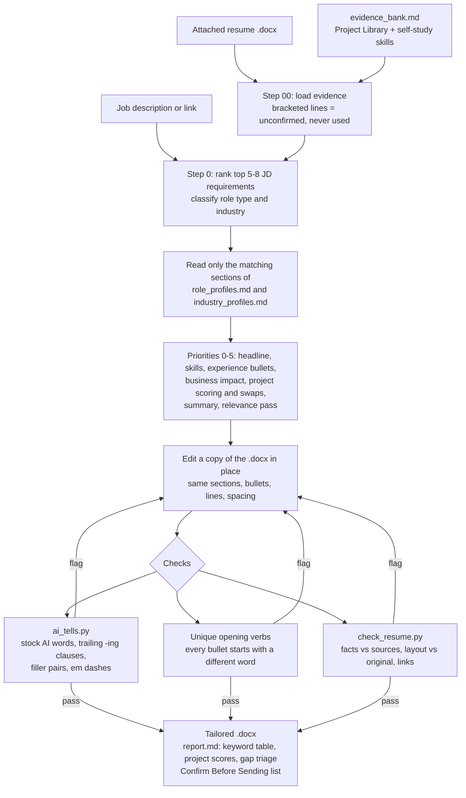

# Architecture

The skill is one folder with four kinds of parts. Each part loads only when a step needs it.

| Part | File | Role |
|---|---|---|
| Instructions | `SKILL.md` | The workflow: steps, rules, guardrails, output format |
| Knowledge base | `evidence_bank.md` | Every true fact, metric and project the candidate can use |
| Profiles | `references/role_profiles.md`, `references/industry_profiles.md` | What each role type screens for, and allowed industry vocabulary. Only the matching sections are read |
| Checks | `scripts/ai_tells.py`, `scripts/check_resume.py` | Deterministic checks the model runs and must pass before delivering |

## Flow

## Project selection

The resume shows only a few projects; the Project Library holds all of them. For each job, the skill chooses the best set:

1. **Candidates:** every project on the resume plus every filled-in Library project.
2. **Hard filters:** "Software Engineer only" or "only when the JD asks for Kafka" drops a project outright.
3. **Scoring against the top JD requirements:**

   | Signal | Points |
   |---|---|
   | Each top requirement the project clearly shows | +3 |
   | "Best for roles" matches the role type | +2 |
   | Domain matches the JD's industry | +1 |
   | Has a real metric | +1 |
   | Covers something the Experience section doesn't | +1 |
   | Tutorial-based | −1 |

4. **Pick one slot at a time, re-scoring after each pick,** so two projects that show the same thing don't take both slots.
5. **Swap, don't stack:** the winner takes the slot of the lowest-scoring resume project, with the same bullet count, and its GitHub link moves with it.

## Why the checks are scripts

Some rules are easy for a model to drift on and easy for code to verify:
- Is every number backed by a source?
- Did any line move on the page?
- Does each GitHub link point at its own project?

Scripts give a pass or a specific flag, and the model fixes and re-runs until they pass. Every flag left over must be explained in the report.
